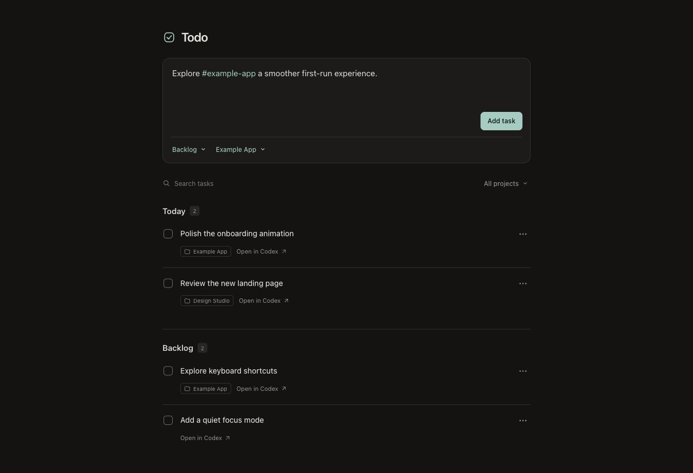

# Codex Todo

A Todo app in Codex.



## Usage

The Todo list is divided into two sections - Today and Backlog. You can use `/today` and `/backlog` Codex commands to add entries to each section directly. The text can even contain a `#hashtag` name of a project you're working on so that a task is assigned directly to it.

### Capture from chat

The plugin includes three skills:

| Skill | Purpose |
| --- | --- |
| `/todo` | Save one idea to Backlog; with no idea, list active tasks. |
| `/today` | Save one idea to Today; with no idea, list today's active tasks. |
| `/backlog` | Exact alias of `todo`: save to Backlog; with no idea, list active tasks. |

Select the skill in the `/` or `$` picker. Hosts can display the full names `codex-todo:todo`, `codex-todo:today` and `codex-todo:backlog`. Capture skills use the same parser as the app. An idea saved through chat stays an idea; capturing it never authorizes starting its work.

### Using the sidebar app

Type an idea and press Enter to add it. Shift+Enter adds a line. The default destination is Backlog. The green text controls below the divider select Today or Backlog and an optional project.

Project tags can appear anywhere in an idea:

```text
/today #Example App improve the welcome screen
/backlog investigate #example-app keyboard shortcuts
```

Exact saved project names match automatically, ignoring case and equivalent spaces or dashes. Multiword and quoted names work. A matching tag turns green, and the project control shows its destination. Partial, misspelled or unknown tags stay plain and show No project; choose a project explicitly or edit the tag before saving. Selecting a project or list updates conflicting annotations so the displayed destination matches the saved task. `/todo` and `/backlog` select Backlog; `/today` selects Today. Literal references such as `C#` and `#1` remain ordinary text.

The checkbox crosses out a task line by line, then folds the row away once the change is saved. Completed tasks stay saved and disappear from Today and Backlog; use Undo in the completion notification to restore one. Reduced motion uses a brief fade. Use a row's menu button to edit, move or delete it. Search covers idea text and project names. Legacy separate titles and notes appear together and remain intact when edited.

**Open in Codex** uses a [documented chat link](https://learn.chatgpt.com/docs/reference/commands#deep-links) to fill the new chat's composer and select the saved project folder. It does not send the prompt or mark the task complete. If the host refuses the link, the app offers a copyable link instead. Automatic chat backlinks and completion detection are outside the current scope.

## Installation

You need the Codex CLI, and Node.js (v22.13 minimum; latest 24 LTS recommended). Installation does not require npm or a source build, just run:

```sh
codex plugin marketplace add milancermak/codex-todo-plugin
codex plugin add codex-todo@todo
```

Restart the desktop app after installation. Open Codex Todo from the sidebar or the More menu; pin it if you want to keep it visible. If your CLI does not expose plugin installation, choose the registered marketplace in the desktop Plugins Directory and install there. These commands and the desktop lifecycle follow the [plugin packaging documentation](https://developers.openai.com/plugins/build/plugins).

You can also install locally - checkout the repo, register and add the plugin directly:

```sh
cd codex-todo-plugin
codex plugin marketplace add .
codex plugin add codex-todo@todo
```

The extracted package is ready to install; npm is only needed for development. Restart the desktop app after installation.

## Projects appear automatically

Todo loads the local projects already saved in Codex when you open the board and keeps their names and folders up to date while it is visible. Choose a project immediately or use its exact name as a tag anywhere in the idea, such as `#Example App` or `#example-app`. There is no project setup step.

Discovery uses the local Codex installation; remote and cloud projects are outside its scope. A compatible Codex CLI is required because the project catalog API is experimental. If discovery is unavailable, tasks and the last saved project list remain usable, and the board explains the problem and offers Retry. Set `TODO_CODEX_CLI` to a compatible executable if the intended CLI cannot be found automatically.


## Data and privacy

Tasks and project mappings live in a local SQLite database. Database selection follows this order:

1. `TODO_DB_PATH`, when explicitly configured.
2. `todo.sqlite` inside the host-provided `PLUGIN_DATA` directory.
3. The platform's user data directory, with a `codex-todo` subdirectory:

| Platform | Fallback database |
| --- | --- |
| macOS | `~/Library/Application Support/codex-todo/todo.sqlite` |
| Windows | `%LOCALAPPDATA%/codex-todo/todo.sqlite`, falling back to `~/AppData/Local/codex-todo/todo.sqlite` |
| Linux | `$XDG_DATA_HOME/codex-todo/todo.sqlite`, falling back to `~/.local/share/codex-todo/todo.sqlite` |

Storage is separate from the installed package cache. No personal project mappings or task database ship with the plugin. Project folders are used for chat routing; the plugin does not read their file contents. Automatic discovery reads local project names and folder paths from Codex’s project catalog and caches them in Todo’s database. It does not start a model conversation.

The plugin runs no external service and needs no additional account or API key. When Codex calls its tools, saved tasks and project mappings can enter the model's context. Opening a chat copies the task text into a composer. Those uses follow the host's account and privacy settings; local SQLite storage is not a promise that every interaction stays exclusively on the device.

## Updates and troubleshooting

To refresh a Git-backed marketplace, then install the available package:

```sh
codex plugin marketplace upgrade todo
codex plugin add codex-todo@todo
```

Restart the desktop app after updating. A running sidebar connection can retain the old server even when the new package is installed. If the board reports a missing UI resource after an update, restart the app and reopen the board before reinstalling again. A fresh chat may also be needed to discover new skills.

If Node cannot be found, make it available to the desktop process and restart the app. If a project cannot be saved, check that its absolute directory exists. Each directory can have one Todo project mapping.

## Develop locally

```sh
npm ci
npm run build
npm test
npm start
```

The preview opens at `http://127.0.0.1:43127`. It is independent of the installed plugin process. A source preview normally uses the OS fallback directory; to share an installed database that lives under `PLUGIN_DATA`, point the preview at that same file explicitly:

```sh
TODO_DB_PATH=/absolute/path/to/todo.sqlite npm start
```

`ui/` contains the interface, `src/` contains the server and storage, and `skills/` contains chat workflows. The build regenerates the self-contained `plugin/` distribution and the repository marketplace. Commit the generated distribution when preparing a release so GitHub installations do not need to build it.

For a local checkout, register the repository root rather than its `plugin/` subdirectory:

```sh
codex plugin marketplace add .
codex plugin add codex-todo@todo
```

With the plugin installed, `npm run verify:skills` checks discovery of all three enabled skills. It uses `codex` by default; set `TODO_CODEX_CLI` to another CLI executable when testing a particular host.

After committing a clean release tree, `npm run package` creates the versioned source-and-bundle archive and `SHA256SUMS` under `releases/`. For version 0.4.1, the archive is `codex-todo-plugin-0.4.1.zip`. Packaging uses the committed Git tree, so uncommitted changes are not silently included.

See [COMPATIBILITY.md](COMPATIBILITY.md) for runtime contracts and verification limits, and [PUBLISHING.md](PUBLISHING.md) for release preparation. The project is available under the [MIT License](LICENSE); bundled dependencies retain the licenses recorded in [THIRD_PARTY_NOTICES.md](THIRD_PARTY_NOTICES.md).
